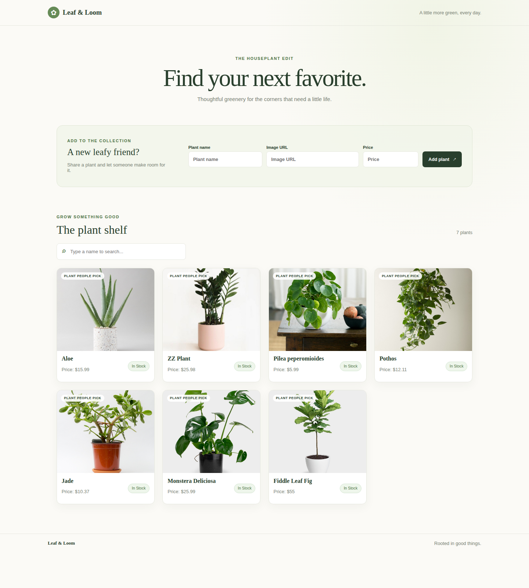

# Leaf & Loom

Leaf & Loom is a small plant-shop catalog for browsing a houseplant collection. It loads plant data from a JSON API and lets a shop manager add plants, mark them in or out of stock, and search by name.



## Features

- Loads plants from the backend when the page opens.
- Adds plants through the new-plant form and immediately shows the created plant.
- Toggles each plant between in-stock and sold-out states.
- Filters the catalog by plant name; clearing the search restores the full catalog.
- Shows loading, empty, and request-error messages.

## Requirements

- Node.js and npm.
- A plants API available at `http://localhost:6001/plants` with `GET` and `POST` support.

## Run locally

1. Start the compatible JSON API on port `6001`.
2. In this directory, install dependencies and start Vite:

   ```sh
   npm install
   npm run dev
   ```
3. Open the local URL printed by Vite.

The API's `GET /plants` endpoint should return an array of plants with `id`, `name`, `image`, and `price` fields. `POST /plants` accepts a JSON object with `name`, `image`, and numeric `price`, then returns the created plant.

## Project scripts

| Command | Description |
| --- | --- |
| `npm run dev` | Start the Vite development server. |
| `npm run build` | Create a production build in `dist/`. |
| `npm run preview` | Preview the production build locally. |
| `npm run lint` | Run ESLint. |

## Implementation notes

The API request and catalog state live in `src/App.jsx`. The form, search field, plant list, and plant card are separate components under `src/components/`.
